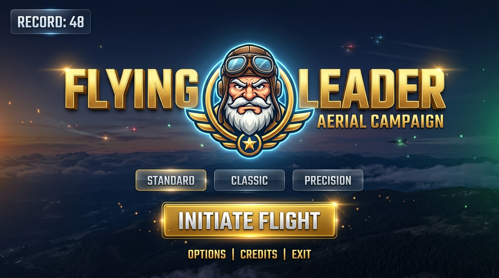

# 🕊️ Flying Leader: Aerial Campaign Odyssey

An arcade flight simulation and satirical endurance runner inspired by classic flappy-mechanics, engineered with high-precision physics, 60fps delta-time rendering, Web Audio synthesis, and responsive full-screen architecture for desktop, tablet, and mobile devices.

---

## 📸 Visual Showcase

### Title & Flight Profile Selection


### In-Flight Gameplay & Obstacle Clearance


---

## 🌟 Key Features

### 🎮 High-Precision 60 FPS Flight Simulation
- **Decoupled Simulation Loop**: The `<canvas>` engine runs in an isolated frame loop decoupled from React state renders, guaranteeing zero-stutter 60 FPS simulation.
- **Clamped Delta Time (`Math.min(dt, 0.05)`)**: Prevents physics tunneling, clipping, or frame skipping when browser tabs blur or throttle.
- **Aerodynamic Feel**: Responsive flap lift, parabolic gravity acceleration, velocity-driven bird tilting, and elastic squash-and-stretch animation.
- **Visual Impact & Feedback**: Camera shake upon collision, 70ms hitstop impact simulation, dynamic hit flash overlays, and pooled particle burst trails.

### 📱 Comprehensive Cross-Device & Mobile UI/UX
- **Edge-to-Edge Responsive Canvas**: Automatically sizes to `100vw × 100vh` across all orientations with native High-DPI (`devicePixelRatio`) sharpness.
- **Viewport Safe-Area Insets**: Formatted for iPhone dynamic islands, screen notches, and Android navigation bars (`viewport-fit=cover`).
- **Mobile Touch Optimization**:
  - Zero-lag tap-to-elevate anywhere on the screen with de-bounced multi-touch event handlers.
  - Native tactile haptic feedback (`navigator.vibrate`) on jump flaps and collision impacts.
  - On-screen ergonomic mobile elevation trigger guide.
- **Speed & Corridor Normalization**: Dynamically scales horizontal transit speed and vertical clearance gaps based on screen aspect ratio so gameplay remains balanced on narrow mobile phones and ultrawide desktop monitors alike.

### 🔊 Robust Web Audio & Cross-Platform Sound System
- **Pre-Decoded Web Audio Buffers**: The jump SFX (`maka.mp3`) and game over cue (`gameover.mp3`) are pre-decoded into in-memory `AudioBuffer`s for immediate, zero-latency trigger response.
- **Automatic Mobile Gesture Unlocking**: Listens for the very first user tap, click, or keypress to immediately resume suspended audio contexts and unblock background music streaming (`music.mp3`).
- **Triple-Layer Audio Fallback**:
  1. *Primary*: Web Audio API `AudioBufferSourceNode` (instantaneous latency on iOS & Android).
  2. *Secondary*: HTML5 `<audio>` element playback with pooled instances.
  3. *Tertiary*: Real-time procedural Web Audio oscillator synthesis (sine/sawtooth waveforms) ensuring audio always plays even under restricted browser permissions.

---

## 🕹️ Flight Difficulty Profiles

| Profile | Corridor Gap | Speed Multiplier | Description |
| :--- | :---: | :---: | :--- |
| **Standard Cadence** | Wide (165px+) | 1.0× | Generous flight clearance with smooth, stable aerodynamic response. Ideal for casual navigation. |
| **Classic Flight** | Balanced (145px+) | 1.25× | The authentic original flight parameters and balanced obstacle clearance. |
| **Precision Challenge** | Narrow (130px) | 1.65× | High velocity navigation through demanding, tight corridors with 2× score multiplier. |

---

## ⌨️ Controls Reference

| Input Action | Desktop Keyboard | Mouse / Pointer | Mobile / Touchscreen |
| :--- | :---: | :---: | :---: |
| **Elevate / Jump Flap** | <kbd>Space</kbd>, <kbd>W</kbd>, <kbd>↑</kbd> | Left Click | Tap Anywhere on Screen |
| **Pause / Resume** | <kbd>Esc</kbd>, <kbd>P</kbd> | Pause Button | Top-Right Pause Icon |
| **Toggle Fullscreen** | <kbd>F</kbd> | Fullscreen Button | Top-Right Maximize Icon |
| **Quick Mute Audio** | <kbd>M</kbd> | Audio Icon | Top-Right Speaker Icon |
| **Quick Launch / Restart** | <kbd>Space</kbd>, <kbd>Enter</kbd> | Primary Action CTA | "Initiate Flight" Button |

---

## 🛠️ Technology Stack

- **Framework**: React 19 (TypeScript)
- **Bundler & Tooling**: Vite 8 with Tailwind CSS v4
- **Graphics & Rendering**: HTML5 Canvas 2D with High-DPI Context Scaling
- **Audio Architecture**: Hybrid Web Audio API (`AudioContext`, `AudioBuffer`) + HTML5 Audio Streaming
- **Icons & Motion**: Lucide React & Tailwind Motion

---

## 📂 Project Structure

```
├── public/
│   ├── screenshots/
│   │   ├── title.jpg           # High-resolution title screen capture
│   │   └── gameplay.jpg        # In-flight obstacle corridor capture
│   └── static/
│       ├── audio/
│       │   ├── maka.mp3        # Jump / flap sound effect
│       │   ├── gameover.mp3    # Impact / debriefing sound effect
│       │   └── music.mp3       # Background campaign soundtrack loop
│       └── images/
│           ├── bird.png        # Flying hero mascot
│           ├── rahul.webp      # Obstacle column portrait texture
│           └── background.webp # High-altitude atmospheric background
├── src/
│   ├── components/
│   │   ├── GameCanvas.tsx      # High-DPI 60fps simulation engine
│   │   ├── TitleScreen.tsx     # Flight profile selection & hero showcase
│   │   ├── GameHUD.tsx         # Low-occlusion live score & perimeter telemetry
│   │   ├── PauseModal.tsx      # Tactical hold overlay & difficulty switch
│   │   └── GameOverModal.tsx   # Flight debriefing report & record tracking
│   ├── types/
│   │   └── game.ts             # TypeScript definitions & entity interfaces
│   ├── utils/
│   │   ├── audio.ts            # Web Audio API engine & mobile auto-unlocker
│   │   └── constants.ts        # Physics constants, difficulty profiles & milestones
│   ├── App.tsx                 # Root application shell & global listeners
│   ├── main.tsx                # React DOM entry point
│   └── index.css               # Tailwind CSS & viewport touch reset rules
├── index.html                  # HTML5 entry with mobile viewport-fit configuration
├── package.json                # Project dependencies and run scripts
└── vite.config.ts              # Vite server & build configuration
```

---

## 🚀 Getting Started

### Prerequisites
- Node.js 18+
- npm or yarn

### Installation
```bash
# Clone the repository
git clone https://github.com/TonyStarkCodes/Flying-Modi.git

# Navigate to project directory
cd Flying-Modi

# Install dependencies
npm install

# Start local development server
npm run dev
```

### Production Build
```bash
# Validate TypeScript and compile production bundle
npm run build
```

---

## 📜 License
Open source and built for interactive entertainment and satire.
